# San Diego Trip Planner

A shared trip planner for a La Jolla / San Diego trip (Sat Oct 31 – Tue Nov 3, 2026): week schedule with drag and drop, prayer times, hourly rain, auto drive times, EV range for a Model 3 Standard, a map of every place, and a list of ideas and backups.

**Live:** https://sd-trip-planner.san-diego-trip-planner.workers.dev (anyone can view; editing needs the shared passphrase)

## Architecture

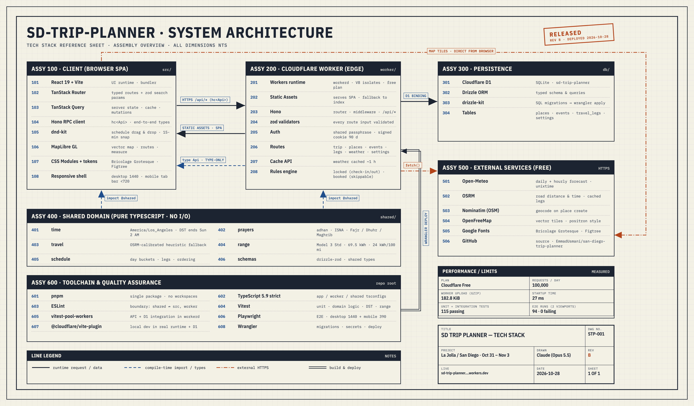

Source: [`docs/diagram/stack.html`](docs/diagram/stack.html) (rendered to PNG with Playwright).

## Screenshots

| Overview | Schedule (week) |
|---|---|
| 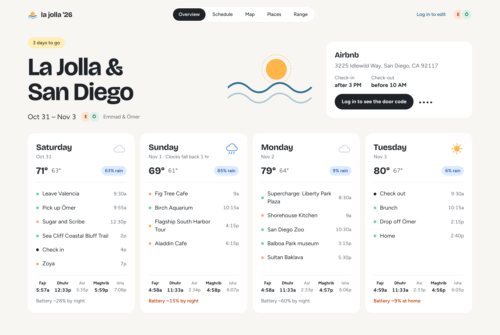 | 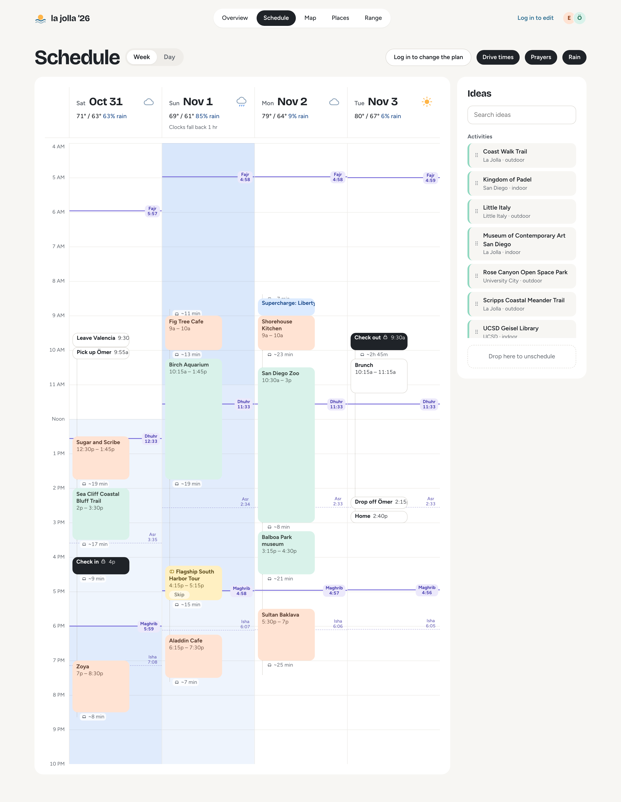 |
| **Schedule (day)** | **Map** |
| 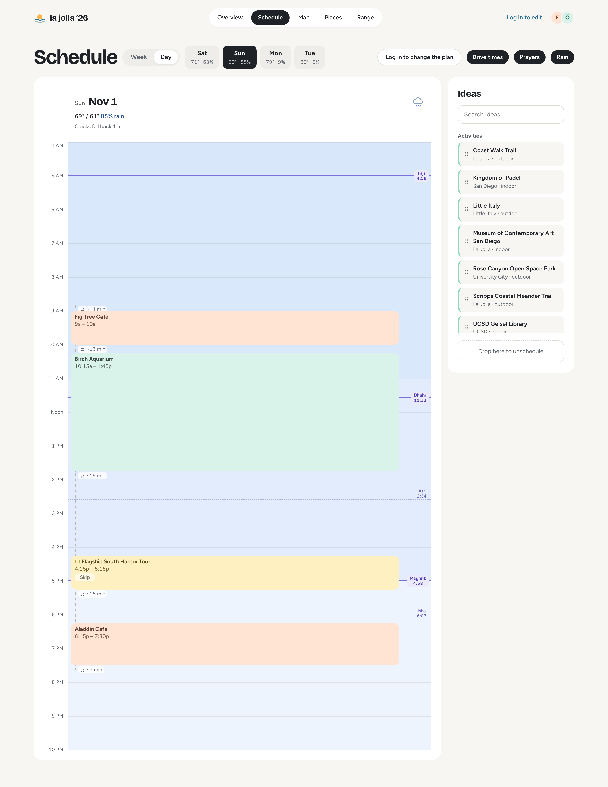 | 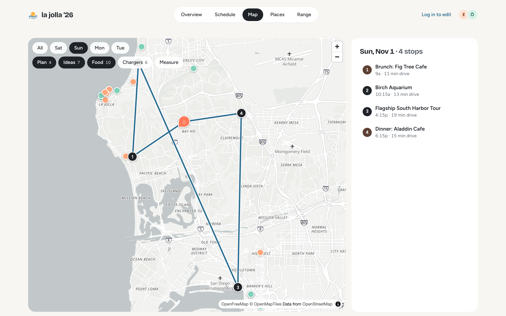 |
| **Places** | **Place detail** |
| 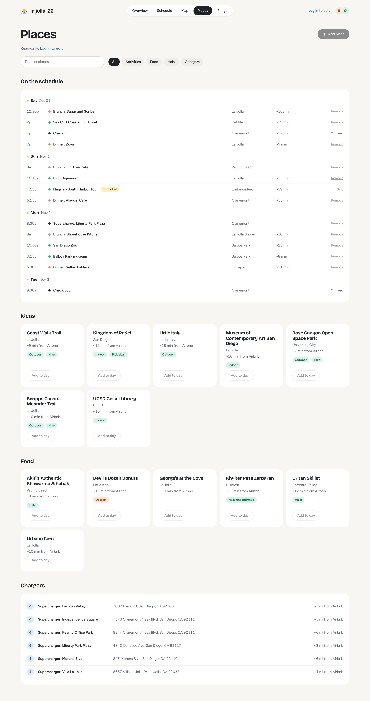 | 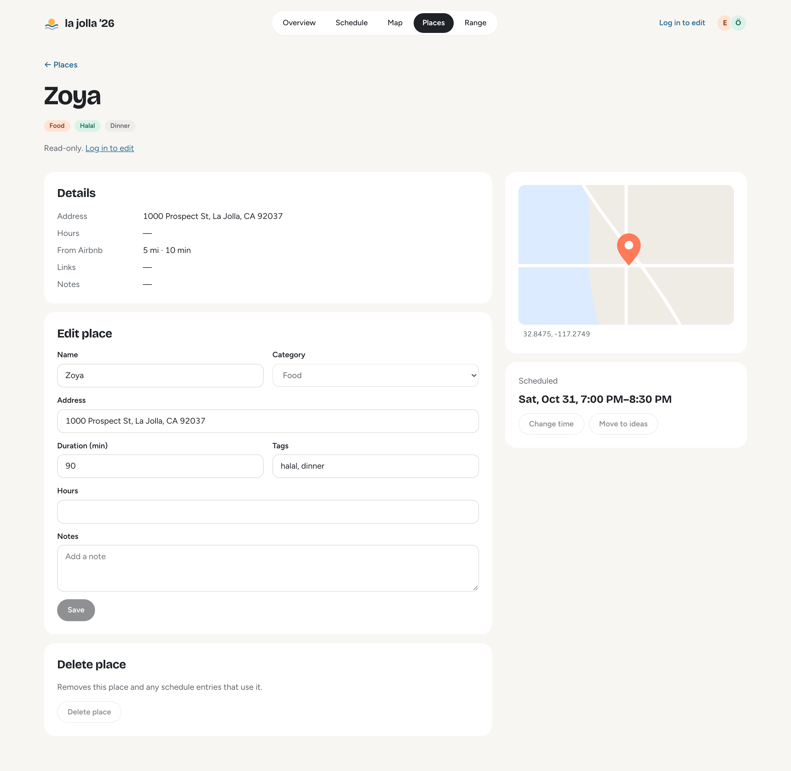 |
| **Range** | |
| 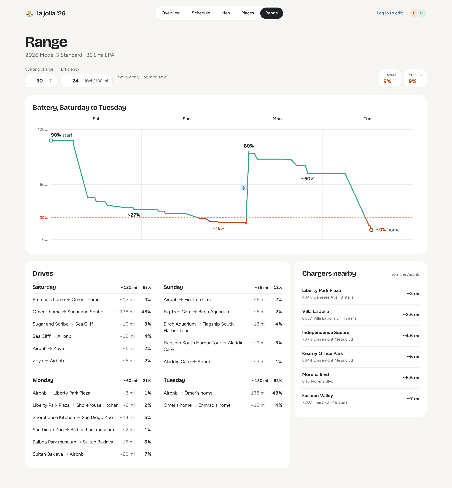 | |

**Mobile**

<p>
  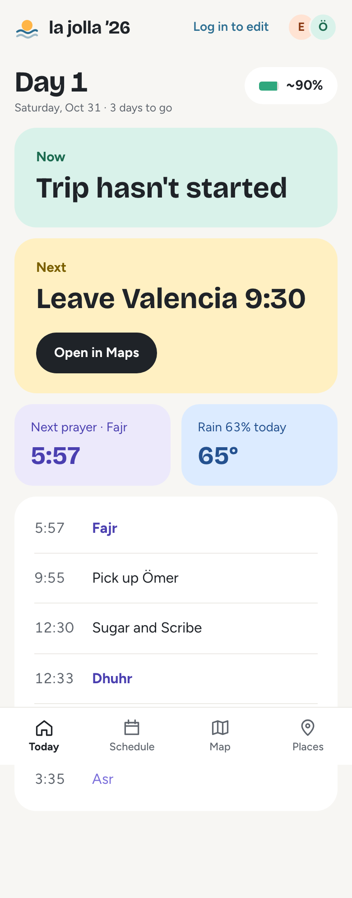
  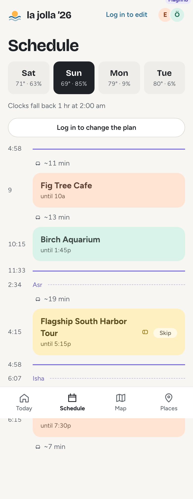
  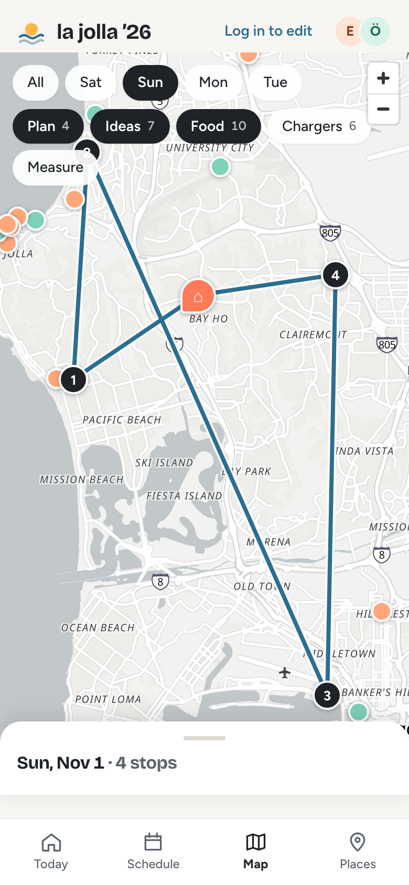
  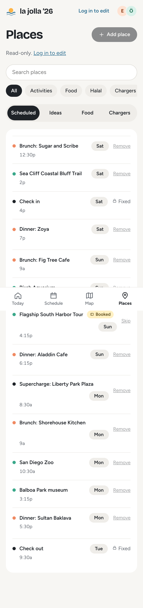
</p>

## Stack

React + Vite, TanStack Router + Query, dnd-kit, MapLibre (OpenFreeMap tiles) · Hono on Cloudflare Workers · D1 + Drizzle · Vitest (unit + Workers pool) and Playwright E2E. Prayer times via `adhan` (ISNA), weather from Open-Meteo, drive times from OSRM with a heuristic fallback.

## Develop

```sh
pnpm install
cp .dev.vars.example .dev.vars   # local password: dev
pnpm db:reset:local
pnpm dev
```

Tests: `pnpm test` (unit + API/D1 integration), `pnpm test:e2e` (Playwright). More in [docs/DEV.md](docs/DEV.md). Design source lives in `design/`.

## Deploy

`pnpm run deploy` (Worker + static assets). Secrets: `wrangler secret put APP_PASSWORD` and `wrangler secret put SESSION_SECRET`. Remote DB: `wrangler d1 migrations apply DB --remote`.
